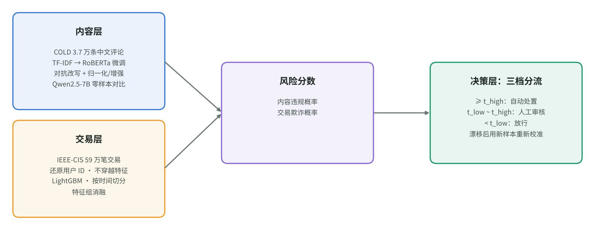
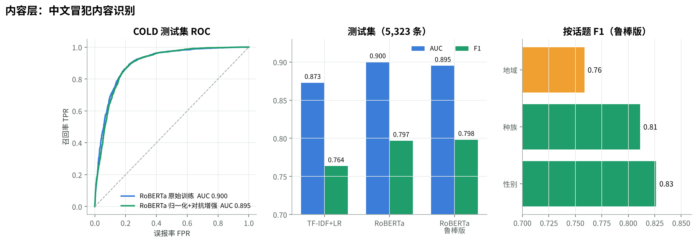
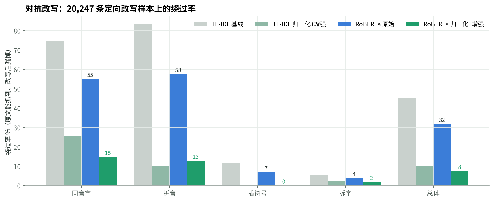
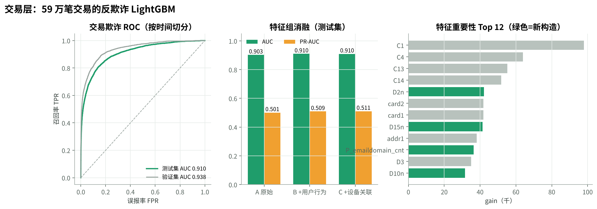
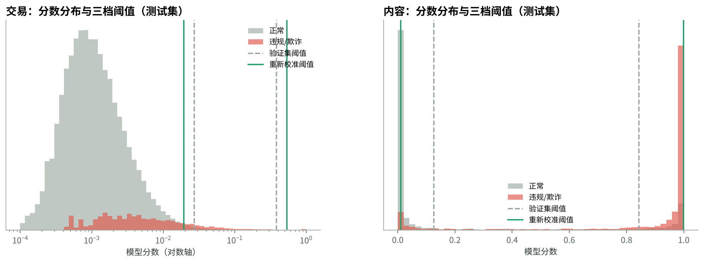
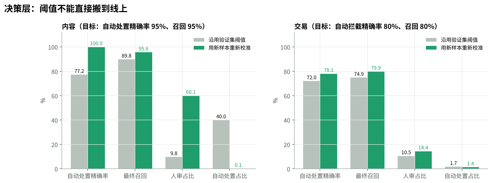

# 社区内容安全与交易反欺诈：识别、对抗防御与分层处置

**Content Safety & Transaction Anti-Fraud — detection, adversarial defense and tiered decisioning**

`Python` · `PyTorch` · `Transformers (RoBERTa-wwm)` · `LightGBM` · `scikit-learn` · `Ollama / Qwen2.5-7B`

| 内容安全（COLD 测试集） | 对抗防御 | 交易反欺诈（IEEE-CIS） | 决策层 |
|---|---|---|---|
| RoBERTa AUC **0.90** / F1 **0.80** | 总绕过率 **32% → 7.6%** | LightGBM AUC **0.903 → 0.910** | 处理 **16%** 交易拦截 **80%** 欺诈 |



> 个人项目。内容层用中文冒犯语言数据集 COLD，交易层用 Kaggle IEEE-CIS 欺诈检测数据；本文所有数字均来自 `results/` 里的真实运行结果（RTX 5060 Laptop，单次运行，随机种子 42）。

## 一、项目要解决什么问题

互联网风控有三条线：信贷风控、内容安全、业务安全（反欺诈/反作弊）。本项目覆盖后两条，并模拟线上的处置流程：

| 层 | 问题 | 数据 | 方法 |
|---|---|---|---|
| 内容层 | 识别冒犯/歧视性评论，并抵抗黑产的规避改写 | COLD，37,480 条中文评论（地域、种族、性别三类话题） | TF-IDF+LR 基线 → 微调 RoBERTa-wwm-ext → 对抗测试 → 归一化+对抗增强；对比 Qwen2.5-7B 零样本审核 |
| 交易层 | 识别欺诈交易/异常账户 | IEEE-CIS，590,540 笔交易，欺诈率 3.50% | 还原用户 ID + 历史行为/交易速度/设备关联特征 + LightGBM，按时间切分，消融实验 |
| 决策层 | 模型分数怎么变成处置动作 | 两层模型的分数 | 自动处置 / 人工审核 / 放行 三档分流，在“误杀”和“漏放”约束下选阈值 |

## 二、内容层

### 1. 数据
COLD（清华 CoAI 发布）：train 25,726 / dev 6,431 / test 5,323，标签 1=冒犯、0=安全。测试集违规占比 39.6%。很多样本是**隐性偏见**（刻板印象、阴阳怪气），而不是直接脏话，所以比一般的脏话识别难。

### 2. 模型效果（测试集，阈值在 dev 上按 F1 最优选）

| 模型 | AUC | F1 | 精确率 | 召回 |
|---|---|---|---|---|
| TF-IDF（字符 1–3 gram）+ 逻辑回归 | 0.873 | 0.764 | 0.716 | 0.819 |
| RoBERTa-wwm-ext 微调（3 epoch，约 8 分钟） | **0.900** | **0.797** | 0.735 | 0.870 |
| RoBERTa-wwm-ext 归一化 + 对抗增强 | 0.895 | 0.798 | 0.733 | 0.877 |

按话题拆分（RoBERTa）：性别 F1 0.82，种族 0.81，**地域 0.76 最难**（地域黑多用调侃语气，语义更隐蔽）。



### 3. 对抗攻击：模拟黑产改写

**怎么构造：**先从 TF-IDF 基线的单字权重里取出“敏感字”（权重最高的如：恶、骂、歧、视、骗、黑、奸、暴……），然后**专门改写文本里最敏感的 20% 的字**，模拟黑产针对敏感词改写的行为。四种改写：

| 变体 | 例子（原文：只要不来中国的外国人就是好外国人） |
|---|---|
| 同音字 | 只要**埠**来中国的外国**仁酒**是好外国**壬** |
| 拼音 | 只要**bu**来中国的外国**renj**是好外国**r** |
| 插符号 | 只要不\*来中国的外国人$就\\是好外国人_ |
| 拆字 | 只要不来中国的外国人就是**女子**外国人 |

对测试集每条样本 × 每种改写生成一条，共 20,247 条（其中违规 8,095 条）。所有模型在**同一份**对抗测试集上评估。

**指标：**“绕过率” = 原文能抓到、改写后漏掉的比例。

| 模型 | 违规召回：原文 → 改写后 | 总绕过率 | 同音字 | 拼音 | 插符号 | 拆字 |
|---|---|---|---|---|---|---|
| TF-IDF 基线 | 82.1% → 45.1% | 45.2% | 74.7% | 83.7% | 11.4% | 5.2% |
| TF-IDF 归一化+对抗增强 | 83.1% → 75.8% | 9.9% | 25.8% | 10.1% | 0.0% | 2.6% |
| RoBERTa 原始训练 | 87.3% → 60.4% | 31.9% | 55.1% | 57.6% | 6.8% | 3.8% |
| **RoBERTa 归一化+对抗增强** | **87.8% → 83.0%** | **7.6%** | 14.8% | 12.8% | 0.0% | 1.8% |

**防御怎么做：**
- **文本归一化**（推理前）：全角转半角、转小写、去掉夹在字中间的符号。专治“插符号”，绕过率降到 0。
- **对抗增强**（训练时）：抽 50% 违规样本 + 等量正常样本，随机做一种改写后加入训练集（新增 12,130 条）。同音字和拼音没法靠规则还原，只能让模型见过。
- **正常样本也要改写**：否则模型会学成“有怪字/拼音就是违规”。验证：鲁棒模型对改写后正常文本的误判率 22.0%，与改写前 21.5% 基本一致；干净文本 F1 也没有下降（0.797 → 0.798）。



### 4. 大模型零样本审核对比
本地部署 Qwen2.5-7B（Ollama，4-bit 量化），提示词说明冒犯定义并提醒注意谐音/拼音规避，只答“是/否”。在测试集分层抽样的同一批 300 条上对比：

| | F1 | 精确率 | 召回 | 单条耗时 |
|---|---|---|---|---|
| Qwen2.5-7B 零样本 | 0.539 | 0.775 | 0.413 | 约 2.2 秒 |
| RoBERTa 鲁棒版 | **0.822** | 0.799 | **0.847** | 毫秒级 |

结论：零样本大模型**漏判严重**（召回 41%），对 COLD 这种隐性偏见的判断标准和标注者不一致，速度也慢 3 个数量级。更适合的定位是：冷启动阶段打标、对小模型的灰区样本做二次复核、给人审提供解释。

## 三、交易层

### 1. 设计要点
- **按时间切分**：第 1–117 天训练（401,567 笔）、117–141 天验证（70,865 笔，用于早停和选阈值）、141–183 天测试（118,108 笔）。模拟“用过去训练、预测未来”，比随机切分更接近上线效果。
- **还原用户 ID**：数据没有用户 ID。用 `card1 + addr1 + (交易日 − D1)` 拼出 uid（D1 是“距开卡的天数”，交易日减去它就是开卡日，同一张卡不变）。
- **不穿越**：所有聚合特征都只用“当前时刻及以前”的数据（累计统计、时间窗口统计），不用未来交易。
- **D 列时间锚点化**：D 列是“距某事件的天数”，同一用户每天都在变；换成“事件发生的日期”（交易日 − D）后对同一用户稳定。

### 2. 特征组与消融（测试集）

| 方案 | 特征数 | AUC | KS | PR-AUC | 审前 1% 的精确率/召回 |
|---|---|---|---|---|---|
| A 原始特征（金额、卡、地址、邮箱、C/D/M 列、设备字段） | 60 | 0.903 | 0.656 | 0.501 | 82.8% / 24.1% |
| B + 用户行为（uid 历史均值/波动、交易速度 1h/24h/7d、D 列锚点化等） | 88 | **0.910** | 0.663 | 0.509 | 84.2% / 24.5% |
| C + 设备关联（设备关联的用户数/卡数、设备 24h 交易数） | 93 | 0.910 | 0.667 | 0.511 | 83.7% / 24.3% |

- **有效的**：D 列锚点化特征进入重要性前 15 的有 4 个（D2n 第 5、D15n 第 8、D10n 第 12、D4n 第 13）；uid 历史金额均值、C 列 uid 均值排在前 30。
- **没效果的**：设备关联特征（C 相对 B 基本持平）。原因：只有 144,233 笔（约 24%）交易带设备信息，覆盖太低。如实保留在报告里。
- 验证集 AUC（0.938）高于测试集（0.910），说明存在时间漂移。



## 四、决策层：三档分流

**规则：**分数 ≥ t_high → 自动处置；t_low ≤ 分数 < t_high → 送人审（假设人审判断正确）；分数 < t_low → 放行。
- t_high：自动处置部分的精确率 ≥ 目标（控制误杀），取满足条件的最低分数线，使自动处置量最大；
- t_low：t_low 以上覆盖的违规比例 ≥ 目标召回，取满足条件的最高分数线，使人审量最小。

### 关键发现：阈值不能直接搬到线上
| 场景 | 阈值在哪选 | 自动处置占比 / 精确率 | 人审占比 | 最终召回 |
|---|---|---|---|---|
| 内容（目标：自动处置精确率 95%，召回 95%） | 验证集 | 40.0% / **77.2%** | 9.8% | 89.8% |
| 内容 | 一半测试集重新校准，另一半评估 | 0.1% / 100% | 60.1% | **95.6%** |
| 交易（目标：自动拦截精确率 80%，召回 80%） | 验证集 | 1.7% / 72.0% | 10.5% | 74.9% |
| 交易 | 一半测试集重新校准，另一半评估 | 1.4% / **78.1%** | 14.4% | **79.9%** |

- **内容层**：COLD 的 dev 与 train 同源（dev F1 0.93），test 是另外标注的（F1 0.80）。在 dev 上满足 95% 精确率的阈值，搬到 test 上精确率只有 77%，**15% 的正常内容会被自动处置**，误杀严重超标。用少量新标注样本重新校准后发现：在这个数据上，模型达不到“95% 精确率自动处置”的要求，正确做法是**不自动处置、只做分流**：60% 的内容送人审、40% 直接放行，召回 95.6%，人审量比全量人审减少约 40%。
- **交易层**：时间漂移让验证集选的阈值在测试期精确率和召回都掉了 5–8 个百分点；重新校准后达到目标附近：**只需处理约 16% 的交易，就能拦截约 80% 的欺诈**，正常交易被误拦截的比例 0.3%。
- 结论：线上要有**阈值监控和定期重新校准**（抽样标注 + 监控分数分布漂移，例如 PSI）。





## 五、局限
- 内容层和交易层用的是两个不同的公开数据集，没有同一平台的“内容 + 账号”关联数据，所以两层是分开建模的，没有做内容和账号的联合判断。
- 对抗样本是按常见手法自己构造的，不等同于真实黑产变体。
- 人审被假设为完全正确；实际人审也有错误率和成本差异。
- 单次运行、单一随机种子，小差异（如 B 与 C 的 0.001）不具有统计意义。

## 六、项目结构

```
├── run_all.py / run_all.bat   一键运行全部步骤
├── src/
│   ├── s01_text_baseline.py   TF-IDF + LR 基线，构造对抗测试集
│   ├── s02_text_bert.py       RoBERTa-wwm 微调（--robust：归一化 + 对抗增强）
│   ├── s03_llm_zero_shot.py   Qwen2.5-7B 零样本审核（Ollama，可选）
│   ├── s04_fraud_lgb.py       交易反欺诈特征工程 + LightGBM + 消融
│   ├── s05_decision.py        三档分流与阈值重新校准
│   └── perturb.py / text_utils.py / common.py / config.py
├── results/                   各步骤的指标 JSON（README 中的数字均出自这里）
└── figures/                   README 图表
```

数据集需自行下载（COLD：Apache-2.0；IEEE-CIS：Kaggle 竞赛规则），不随仓库分发。

## 七、复现
见 `运行说明.md`。一键运行：`python run_all.py`；结果在 `results/`，日志在 `results/run_log.txt`。
